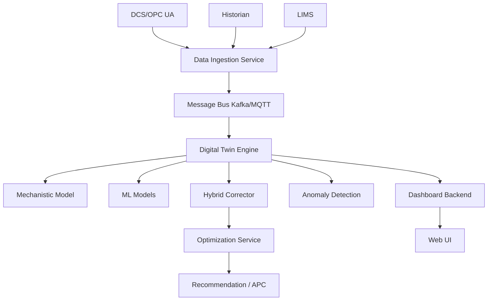

# inno-Jam-Petrochemical-polymerization-digitwin
# Software Requirements Specification (SRS)
## Comprehensive Process Digital Twin Platform
### Jam Petrochemical Company

| Version | Date | Description |
|------|--------|----------|
| 1.0 | 1403/06/09 | Initial draft based on international benchmark |

---

## Table of Contents
1. Introduction
2. System Overview
3. Functional Requirements
4. Non-Functional Requirements
5. Data Requirements
6. User Interface and API Requirements
7. Proposed Architecture
8. International Benchmark and Lessons Learned
9. Synthetic Code Samples
10. Acceptance and Testing
11. Risks

---

## 1. Introduction

### 1.1 Purpose
The purpose of this document is to specify the software requirements for developing a **polymerization process digital twin platform** at the Jam Petrochemical complex. Beyond simple virtual sensors, this platform must provide, in real time, full simulation of reaction kinetics, heat transfer, reactor hydrodynamics and product quality optimization (such as melt index, density, molecular weight distribution).

### 1.2 Scope
- HDPE, LLDPE and PP polymerization units.
- Integration with DCS, Historian, LIMS and APC.
- Hybrid modeling (mechanistic + machine learning).
- Management and engineering dashboards.
- Real-time optimization and What-if scenario analysis.

### 1.3 Definitions and Abbreviations
| Term | Definition |
|------|-------|
| DT | Digital Twin |
| DCS | Distributed Control System |
| OPC UA | Open Platform Communications Unified Architecture |
| MI | Melt Index |
| MWD | Molecular Weight Distribution |
| RTO | Real-Time Optimization |
| APC | Advanced Process Control |
| FMI/FMU | Functional Mock-up Interface/Unit |
| MLOps | Machine Learning Operations |

### 1.4 References
- ISA-95, ISA-88 (manufacturing systems integration standards)
- IEC 62443 (cybersecurity of industrial control systems)
- ISO 15746 (digital twin)
- International examples: AVEVA Digital Twin, AspenTech Hybrid Models, Siemens COMOS, Honeywell Forge, SEEQ, Cognite Data Fusion

---

## 2. System Overview

### 2.1 Product Vision
A scalable and open platform that can:
- Receive process data at a high sampling rate (down to 1 second).
- Run accurate kinetic models of the polymerization reactor.
- Calibrate models using laboratory data (LIMS).
- Suggest optimized operating parameters for the target quality.
- Be able to connect to APC/DCS systems for automatic application of setpoints.

### 2.2 System Users
- **Process engineer**: real-time monitoring, scenario analysis, model tuning.
- **Control room operator**: alerts, quality prediction, operational recommendations.
- **Production manager**: KPI dashboard, quality reports, trend analysis.
- **IT/OT unit**: access management, data integration, infrastructure maintenance.

### 2.3 Operating Environment
- Jam Petrochemical's internal servers (On-Premise) or a private cloud.
- Linux operating system (preferably RHEL 8+).
- Docker/Kubernetes for microservice deployment.
- Secure connection to the industrial network (Purdue Model level 3.5).

### 2.4 Design Constraints
- Quality prediction latency must not exceed 30 seconds.
- Mechanistic models must be able to run on ordinary CPUs.
- All data must remain within the organization's boundary.
- Compliance with security and audit requirements.

### 2.5 Dependencies
- Access to DCS data via OPC UA/DA.
- Connection to Historian (such as PI System or Aspen InfoPlus.21).
- Connection to LIMS for laboratory data.
- API of the existing APC system.

---

## 3. Functional Requirements

### FR-1: Data Acquisition and Integration
| ID | Requirement | Priority |
|-------|-----------|--------|
| FR-1.1 | The system must support the OPC UA protocol with Sign & Encrypt security. | Essential |
| FR-1.2 | Support for MQTT/Sparkplug B for IoT data. | Desirable |
| FR-1.3 | Connection to the Historian via REST API or SDK to read historical data. | Essential |
| FR-1.4 | Collection of laboratory data (LIMS) as CSV/Excel files or via API. | Essential |
| FR-1.5 | Data validation: physical range, rate of change, outlier detection. | Essential |

**Synthetic code sample (OPC UA connection):**
```python
from opcua import Client
import ssl

client = Client("opc.tcp://10.12.5.20:4840")
client.set_security_string("Basic256Sha256,SignAndEncrypt,cert.pem,key.pem")
client.connect()
node = client.get_node("ns=2;i=103")  # Temperature Reactor R-201
temp = node.get_value()
print(f"Reactor Temp: {temp}°C")
```

### FR-2: Virtual Sensors (Soft Sensors)
| ID | Requirement | Priority |
|-------|-----------|--------|
| FR-2.1 | Develop virtual sensor models for quality variables: MI, density, melt ratio, copolymer fraction. | Essential |
| FR-2.2 | Use PLS, PCA, Gaussian Process and neural network methods. | Essential |
| FR-2.3 | Update models periodically or based on prediction error. | Essential |
| FR-2.4 | Evaluate performance with R², RMSE and MAPE on test data. | Essential |

**Synthetic code sample (PLS model):**
```python
from sklearn.cross_decomposition import PLSRegression
import numpy as np

# X_train: reactor temperature, pressure, hydrogen/ethylene ratio, comonomer feed
# y_train: melt index (MI)
model = PLSRegression(n_components=4, scale=True)
model.fit(X_train, y_train)

def predict_mi(X_new):
    return model.predict(X_new)[0][0]
```

### FR-3: Mechanistic Polymerization Model
| ID | Requirement | Priority |
|-------|-----------|--------|
| FR-3.1 | Comprehensive kinetic model for ethylene and propylene polymerization (Ziegler-Natta or metallocene catalyst). | Essential |
| FR-3.2 | Simulation of molecular weight distribution (MWD) and copolymer composition distribution (CCD). | Essential |
| FR-3.3 | Reactor heat transfer model (jacket, condenser) and phase hydrodynamics. | Essential |
| FR-3.4 | Solving ODEs with stable numerical methods (LSODA, BDF). | Essential |
| FR-3.5 | Ability to export and import models in FMU/FMI format for co-simulation. | Desirable |

**Synthetic code sample (simple polymerization kinetics):**
```python
import numpy as np
from scipy.integrate import solve_ivp

def kinetics(t, y, params):
    # y = [M, C, T] : monomer conc, catalyst conc, temp
    M, C, T = y
    kp = params['A0'] * np.exp(-params['Ea']/(8.314*T))
    kd = params['A0d'] * np.exp(-params['Ead']/(8.314*T))
    dMdt = -kp * C * M
    dCdt = -kd * C
    dTdt = params['UA']*(params['Tj'] - T)/(params['rho']*params['Cp']*params['V'])
    return [dMdt, dCdt, dTdt]

sol = solve_ivp(kinetics, [0, 3600], [5.0, 0.01, 343], args=(params,), method='LSODA')
```

### FR-4: Hybrid Model (Mechanistic + ML)
| ID | Requirement | Priority |
|-------|-----------|--------|
| FR-4.1 | Combine the kinetic model with a machine learning error model (Residual Learning). | Essential |
| FR-4.2 | Use neural networks to correct kinetic parameters online. | Desirable |
| FR-4.3 | Store different model versions and manage the model lifecycle (MLOps). | Essential |

**Synthetic code sample (error correction):**
```python
import torch
import torch.nn as nn

class ResidualCorrector(nn.Module):
    def __init__(self, input_dim, hidden=64):
        super().__init__()
        self.net = nn.Sequential(
            nn.Linear(input_dim, hidden),
            nn.ReLU(),
            nn.Linear(hidden, 1)
        )
    def forward(self, x):
        return self.net(x)

# y_hybrid = y_mechanistic + residual_model(X)
```

### FR-5: Real-Time Simulation and Prediction
| ID | Requirement | Priority |
|-------|-----------|--------|
| FR-5.1 | Run the model at configurable intervals (e.g., every 1 minute). | Essential |
| FR-5.2 | Predict product quality 30 minutes to 2 hours ahead. | Essential |
| FR-5.3 | Detect process deviation and provide early warning. | Essential |
| FR-5.4 | What-if simulation by changing input parameters. | Essential |

### FR-6: Product Quality Optimization
| ID | Requirement | Priority |
|-------|-----------|--------|
| FR-6.1 | Optimize setpoints (H2/C2, reactor temperature, comonomer feed) to achieve the target MI. | Essential |
| FR-6.2 | Nonlinear optimization algorithms (SQP, GA, PSO) with operational constraints. | Essential |
| FR-6.3 | Provide recommendations to the operator or send directly to the APC. | Desirable |
| FR-6.4 | Calculate the economic profit of each scenario. | Desirable |

**Synthetic code sample (MI optimization):**
```python
from scipy.optimize import minimize

def objective(u):
    # u = [H2/C2, Temp, Comonomer/C2]
    MI_pred = hybrid_model(u)
    return (MI_pred - MI_target)**2 + 0.1*np.sum((u-u0)**2)

bounds = [(0.1, 1.5), (75, 90), (0.01, 0.15)]
res = minimize(objective, u0, method='SLSQP', bounds=bounds)
optimal_setpoints = res.x
```

### FR-7: Scenario Building and What-if Analysis
| ID | Requirement | Priority |
|-------|-----------|--------|
| FR-7.1 | Ability to change input variables manually or via slider. | Essential |
| FR-7.2 | Run multiple scenarios in parallel and compare results. | Essential |
| FR-7.3 | Save scenarios for reuse. | Essential |

### FR-8: Anomaly Detection and Alerting
| ID | Requirement | Priority |
|-------|-----------|--------|
| FR-8.1 | Anomaly detection with Isolation Forest, LSTM-AE or PCA. | Essential |
| FR-8.2 | Send alerts via email, SMS or dashboard notification. | Essential |
| FR-8.3 | Define alert levels (Info, Warning, Critical). | Essential |

### FR-9: Dashboard and Reporting
| ID | Requirement | Priority |
|-------|-----------|--------|
| FR-9.1 | Display real-time trends of key variables and predicted quality. | Essential |
| FR-9.2 | Molecular weight distribution and copolymer composition charts. | Essential |
| FR-9.3 | Daily, weekly and monthly quality reports. | Essential |
| FR-9.4 | PDF/Excel export. | Essential |

### FR-10: User Management and Security
| ID | Requirement | Priority |
|-------|-----------|--------|
| FR-10.1 | Authentication with Active Directory or LDAP. | Essential |
| FR-10.2 | Role-based access control (RBAC). | Essential |
| FR-10.3 | Logging of all events (Audit Log) with timestamps. | Essential |
| FR-10.4 | TLS 1.3 communication encryption. | Essential |

---

## 4. Non-Functional Requirements

| ID | Category | Requirement |
|-------|------|----------|
| NFR-1 | Performance | Quality prediction latency ≤ 30 seconds |
| NFR-2 | Performance | Processing throughput of 5000 tags at 1-second rate |
| NFR-3 | Availability | 99.9% during the operating period |
| NFR-4 | Scalability | Capacity increase by adding nodes without downtime |
| NFR-5 | Security | Compliance with IEC 62443-3-3 level SL2 |
| NFR-6 | Maintainability | Complete documentation of API and models |
| NFR-7 | Reliability | MTBF ≥ 8760 hours |
| NFR-8 | Recovery | RPO ≤ 5 minutes, RTO ≤ 15 minutes |

---

## 5. Data Requirements

### 5.1 Data Sources
| Source | Protocol | Rate | Description |
|------|--------|-----|---------|
| DCS | OPC UA | 1s | Temperature, pressure, flow, level |
| Historian | REST/SDK | 1min | Historical data |
| LIMS | CSV/API | 2-4h | Laboratory results for MI, density |
| APC | OPC UA/API | 30s | Setpoints and status |

### 5.2 Data Model
```sql
CREATE TABLE process_data (
    ts TIMESTAMPTZ NOT NULL,
    tag VARCHAR(64) NOT NULL,
    value DOUBLE PRECISION,
    quality INT,
    PRIMARY KEY (tag, ts)
);

CREATE TABLE quality_predictions (
    ts TIMESTAMPTZ PRIMARY KEY,
    product_grade VARCHAR(20),
    predicted_mi DOUBLE PRECISION,
    predicted_density DOUBLE PRECISION,
    model_version VARCHAR(20)
);
```

---

## 6. User Interface and API Requirements

### 6.1 User Interface
- Responsive dashboard (React/Angular) with Plotly/D3 charts.
- Simplified P&ID display with live values.
- Scenario-building sliders.

### 6.2 API
- RESTful API with OpenAPI 3.0 documentation.
- WebSocket for real-time data.
- Example:
```
GET /api/v1/predict/{unit}/quality?horizon=60
POST /api/v1/whatif
{
  "unit": "PP-1",
  "changes": {"H2/C2": 0.35, "Temp": 78},
  "horizon_min": 120
}
```

---

## 7. Proposed Architecture



- **Deployment**: Kubernetes for scalability, each service in a separate container.
- **Storage**: TimescaleDB or InfluxDB for time series, PostgreSQL for reference data.
- **Model management**: MLflow or DVC for versioning.

---

## 8. International Benchmark and Lessons Learned

Based on an analysis of global platforms, the following features were added to this SRS:

| Reference platform | Key feature | Added to SRS |
|-------------|-------------|---------------|
| **AVEVA Digital Twin** | FMI/FMU models and simulator integration | FR-3.5 FMU export |
| **AspenTech Hybrid Models** | Combining kinetic models with ML | FR-4 hybrid model |
| **Siemens COMOS** | Asset lifecycle management | FR-10 asset management (optional) |
| **Honeywell Forge** | Predictive alerting and real-time RTO | FR-6 optimization |
| **Cognite Data Fusion** | Industrial data model and access to historical data | NFR-6 and data model |
| **SEEQ** | Data analysis and working with Historian | FR-1.3 Historian connection |

---

## 9. Synthetic Code Samples

### 9.1 Model Calibration Service with Ensemble Kalman Filter (EnKF)
```python
import numpy as np

def enkf_update(ensemble, observation, R):
    """
    ensemble: shape (N_state, N_ens)
    observation: scalar
    R: observation noise variance
    """
    N_state, N_ens = ensemble.shape
    H = np.zeros((1, N_state))
    H[0, 0] = 1  # observe first state
    # forecast mean and covariance
    xf_mean = np.mean(ensemble, axis=1)
    Pf = np.cov(ensemble)
    # Kalman gain
    K = Pf @ H.T @ np.linalg.inv(H @ Pf @ H.T + R)
    # analysis update
    innovation = observation - H @ xf_mean
    ensemble_analysis = np.zeros_like(ensemble)
    for i in range(N_ens):
        ensemble_analysis[:, i] = ensemble[:, i] + K @ (innovation + np.random.normal(0, np.sqrt(R)))
    return ensemble_analysis
```

### 9.2 Data Stream Processing with Kafka
```python
from kafka import KafkaProducer, KafkaConsumer
import json

producer = KafkaProducer(
    bootstrap_servers='kafka:9092',
    value_serializer=lambda v: json.dumps(v).encode('utf-8')
)

def send_measurement(tag, value, ts):
    msg = {'tag': tag, 'value': value, 'ts': ts}
    producer.send('process_data', value=msg)

consumer = KafkaConsumer(
    'quality_predictions',
    bootstrap_servers='kafka:9092',
    value_deserializer=lambda m: json.loads(m.decode('utf-8'))
)
for message in consumer:
    handle_prediction(message.value)
```

### 9.3 Anomaly Detection with Isolation Forest
```python
from sklearn.ensemble import IsolationForest

model = IsolationForest(n_estimators=100, contamination=0.01, random_state=42)
model.fit(X_train_normal)

def is_anomaly(x_new):
    score = model.decision_function([x_new])[0]
    return score < -0.05  # threshold
```

### 9.4 Quality Prediction API (FastAPI)
```python
from fastapi import FastAPI, HTTPException
from pydantic import BaseModel

app = FastAPI()

class QualityRequest(BaseModel):
    unit: str
    inputs: dict

@app.post("/api/v1/predict/quality")
async def predict_quality(req: QualityRequest):
    try:
        prediction = digital_twin.predict(req.inputs)
        return {"unit": req.unit, "prediction": prediction}
    except Exception as e:
        raise HTTPException(status_code=500, detail=str(e))
```

### 9.5 Parallel Simulation and Scenario Building
```python
from concurrent.futures import ThreadPoolExecutor

def run_scenario(scenario_id, changes):
    model = DigitalTwinModel(version='v2.3.1')
    model.apply_changes(changes)
    result = model.simulate(horizon=120)
    return scenario_id, result

scenarios = [
    {'id': 's1', 'changes': {'H2/C2': 0.30, 'Temp': 78}},
    {'id': 's2', 'changes': {'H2/C2': 0.35, 'Temp': 80}},
    {'id': 's3', 'changes': {'H2/C2': 0.40, 'Temp': 82}},
]

with ThreadPoolExecutor(max_workers=3) as executor:
    futures = [executor.submit(run_scenario, s['id'], s['changes']) for s in scenarios]
    for f in futures:
        print(f.result())
```

---

## 10. Acceptance and Testing

### 10.1 Acceptance Criteria
- MI prediction error on test data below 5% MAPE.
- System latency from data reception to prediction display below 30 seconds in 95% of cases.
- Fault tolerance: failure of one service must not disrupt the whole system.
- Penetration testing according to the IEC 62443 checklist.

### 10.2 Test Scenarios
| ID | Test | Expectation |
|-------|-----|--------|
| T-1 | Sudden change in reactor temperature | Alert in under 10 seconds |
| T-2 | Missing data from DCS | Use the last valid value and raise an alert |
| T-3 | What-if scenario with comonomer change | Display the new quality prediction |
| T-4 | Optimization for target MI | Provide setpoints within the allowed range |

---

## 11. Risks

| Risk | Probability | Impact | Mitigation |
|------|--------|-------|--------|
| Kinetic model mismatch with reality | Medium | High | Periodic calibration with LIMS data and use of a hybrid model |
| OPC UA network delay | Low | Medium | Use of a local buffer and Kafka broker |
| Operator resistance to adopting the system | Medium | Medium | Training and demonstrating added value |
| Product grade change | High | Low | Design the model for multiple grades |

---

**End of document**.

---

## Implementation status (TRL 4 scaffold)

Branch `trl4-scaffold` adds `src/jam_twin/` (data validation, kinetic model, PLS virtual sensor, residual learning, set-point optimisation, anomaly alerts), `tests/` (7 tests), CI and [`docs/TRL.md`](docs/TRL.md) with the evidence and the limits. Run: `pip install -e ".[dev]" && pytest`.
